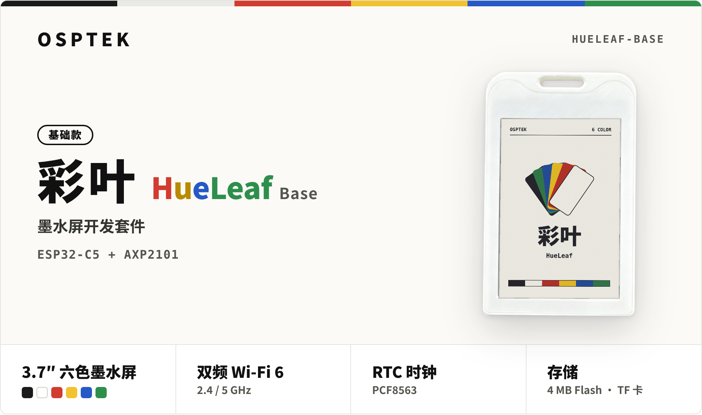
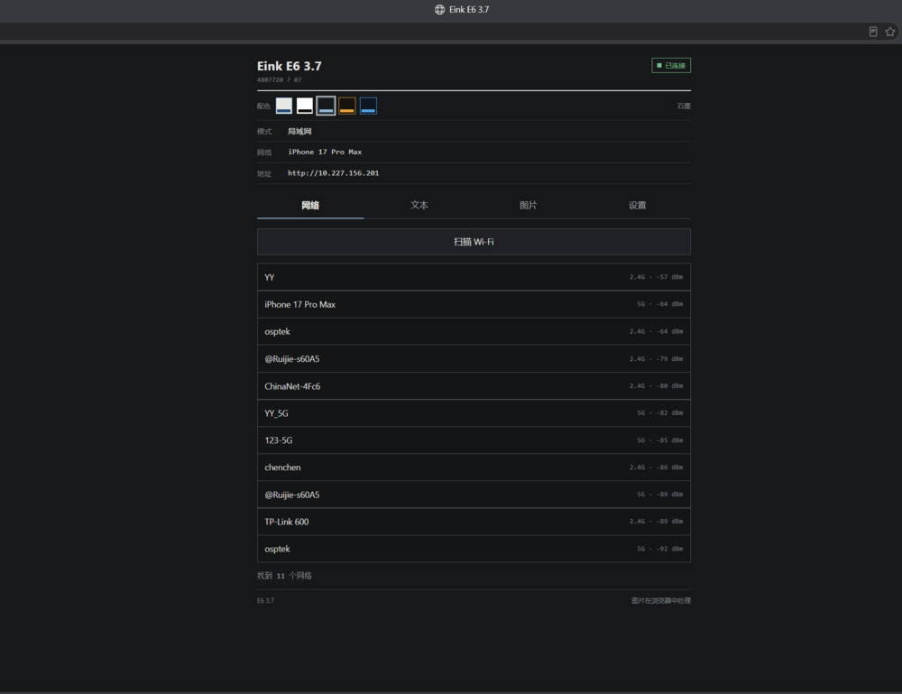
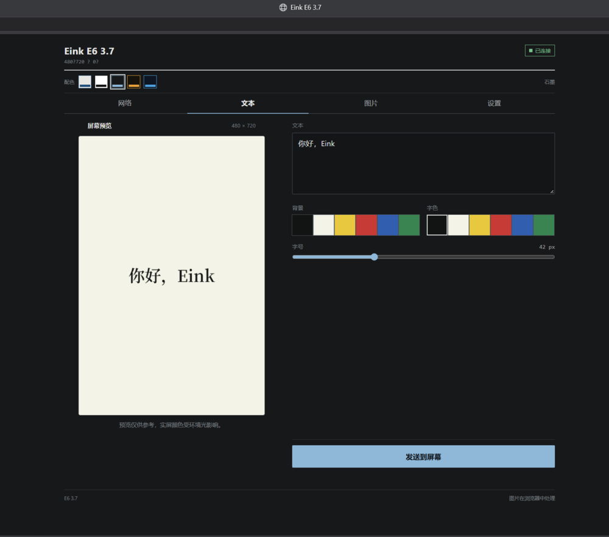
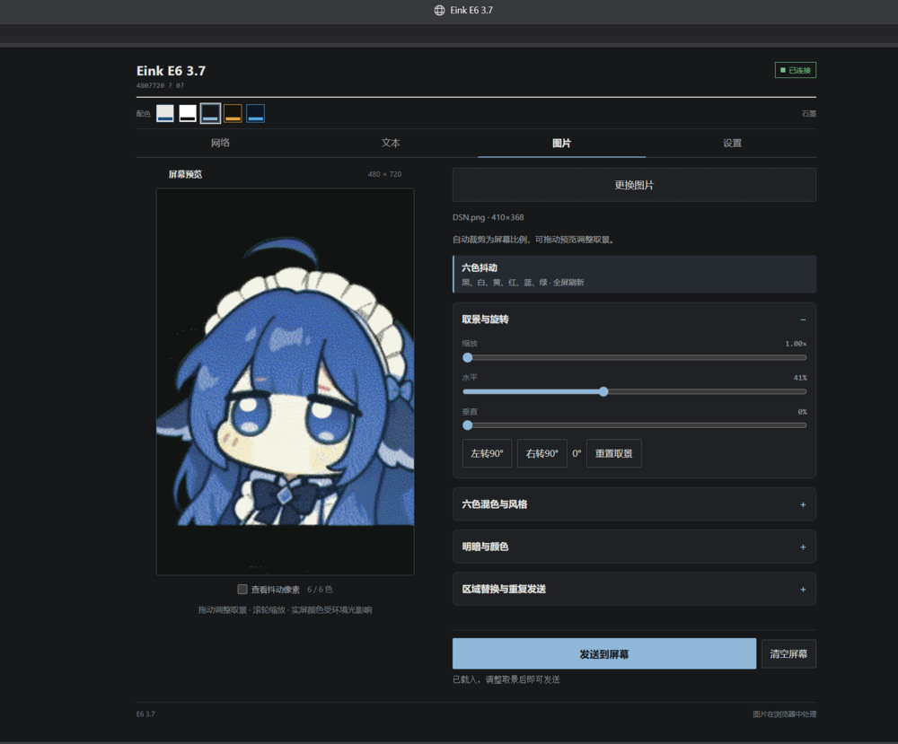
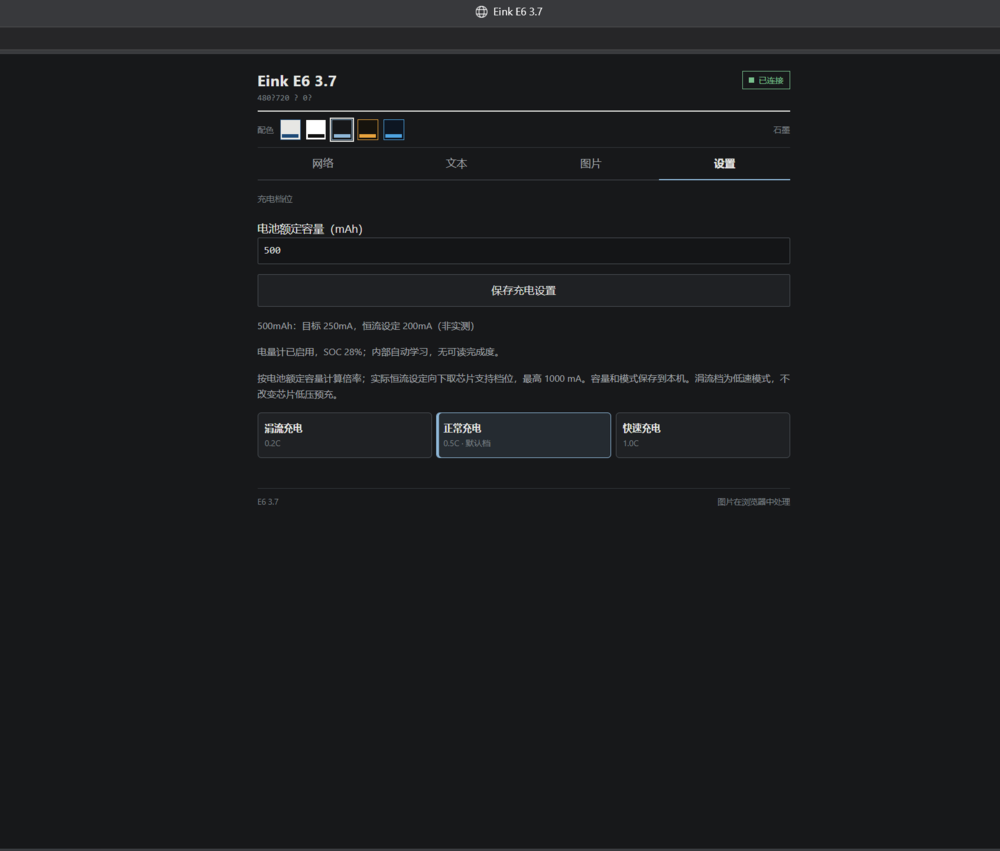

# 彩叶（基础版） HueLeaf Base

OSPTEK 墨水屏开发套件 · ESP32-C5 主控 · 3.7″ 六色墨水屏 · 双频 Wi-Fi 6

<p align="center">
  
</p>

<p align="center">
  
  
  
  
  
</p>

<p align="center">
  <b>简体中文</b> &nbsp;|&nbsp; <a href="README_EN.md">English</a>
</p>


## 简介

彩叶 HueLeaf 是 OSPTEK 推出的墨水屏开发套件，本仓库对应其基础版。

基础版以 ESP32-C5 为主控，搭载一块 3.7 英寸六色墨水屏，可显示黑、白、红、黄、蓝、绿六种颜色。板上集成 AXP2101 电源管理芯片、PCF8563 RTC 时钟、MSA321 加速度计、4 MB Flash 和 TF 卡槽，ESP32-C5 提供 2.4 GHz / 5 GHz 双频 Wi-Fi 6 连接。

整机采用挂牌式外壳，可以挂在胸前当电子工牌，也可以放在桌面上使用。墨水屏只在刷新画面时耗电，配合 AXP2101 的锂电池管理和 PCF8563 的定时唤醒，设备可以长时间休眠、按需刷新，适合用电池长期供电。

本仓库面向二次开发，提供基于 ESP-IDF 的示例代码、出厂固件和硬件资料。

### 典型用途

- 电子工牌、会议胸牌
- 桌面日历、天气时钟
- 信息看板、消息提醒
- 电子价签、门牌标识

## 硬件规格

| 项目 | 参数 |
| :--- | :--- |
| 主控 | ESP32-C5（ESP32-C5HF4） |
| 显示屏 | 3.7″ 六色墨水屏 EPD037A02，480 × 720（黑、白、红、黄、蓝、绿） |
| 无线 | 双频 Wi-Fi 6，2.4 / 5 GHz |
| 电源管理 | AXP2101 |
| RTC 时钟 | PCF8563 |
| 加速度计 | MSA321 |
| 存储 | 4 MB Flash，TF 卡 |
| USB | Type-C，ESP32-C5 原生 USB |
| 按键 | 复位键、电源键、BOOT 键 |
| 指示灯 | 充电指示（蓝）、开机指示（绿） |

完整原理图见 [hardware/HueLeaf_Base_Schematic_V1.0.pdf](hardware/HueLeaf_Base_Schematic_V1.0.pdf)，元件位置见位号图 [hardware/HueLeaf_Base_Placement.pdf](hardware/HueLeaf_Base_Placement.pdf)。

### 引脚分配

| 功能 | GPIO | 说明 |
| :--- | :--- | :--- |
| SPI MOSI | 0 | 墨水屏与 TF 卡共用 |
| SPI CLK | 1 | 墨水屏与 TF 卡共用 |
| SPI MISO | 9 | TF 卡 |
| 墨水屏 CS / DC / RST / BUSY | 5 / 6 / 7 / 8 | |
| TF 卡 CS | 10 | |
| I2C SDA / SCL | 2 / 3 | AXP2101、PCF8563、MSA321 共用 |
| 加速度计中断 | 4 | MSA321 |
| RTC 中断 | 23 | PCF8563 |
| PMIC 中断 | 25 | AXP2101 |
| BOOT 键 | 28 | 低电平有效 |

| I2C 设备 | 地址 |
| :--- | :--- |
| AXP2101 | `0x34` |
| PCF8563 | `0x51` |
| MSA321 | `0x62` |

## 仓库内容

| 目录 | 内容 |
| :--- | :--- |
| [`examples/`](examples) | 示例代码与出厂固件 |
| [`hardware/`](hardware) | 原理图、位号图 |

## 开发环境

示例代码基于 [ESP-IDF](https://github.com/espressif/esp-idf) 开发。

## 示例

### 3.7einkDvb 网页传图

用手机或电脑打开网页，把图片或文字发送到墨水屏上显示。代码位于 [`examples/3.7einkDvb`](examples/3.7einkDvb)。

<p align="center">
  
</p>

#### 出厂固件功能

出厂固件由本示例编译而来，支持以下功能：

| 类别 | 功能 |
| :--- | :--- |
| 显示 | 传图、刷图、清屏与恢复屏幕；BOOT 键旋转画面 90°，电源键单击全屏刷白 / 恢复 |
| 刷图模式 | 六色抖动、黑白抖动 |
| 网络 | 热点（AP）配网与连接路由器（STA），支持 2.4 GHz / 5 GHz 双频 Wi-Fi 6 |
| 充电 | AXP2101 电量计及电池容量自学习；可设定电池标称容量，按 0.2C / 0.5C / 1C 调整充电电流，最大 1000 mA |
| 开关机 | 按住电源键 0.5 秒开机，按住 4 秒关机 |
| TF 卡 | 驱动已内置，支持初始化 |
| 加速度计 | MSA321 驱动已内置，支持初始化与读数 |
| RTC | PCF8563 驱动已内置，支持初始化与读写 |

> [!NOTE]
> 48 / 64 / 256 / 384 / 512 色全局刷新（约 23 秒）、局部刷新（约 23 秒）、快速刷新（约 3 秒）、局部快速刷新（约 2 秒）等功能暂未开放，将在后续版本中更新。TF 卡、加速度计、RTC 的应用功能也将在后续版本中更新。

#### 烧录

**方式一：直接烧录出厂固件**

固件为合并镜像，从 `0x0` 地址烧录：

```bash
esptool.py --chip esp32c5 write_flash 0x0 examples/3.7einkDvb/firmware/3.7einkDvb_factory_0x0.bin
```

**方式二：从源码编译烧录**

```bash
cd examples/3.7einkDvb
idf.py build flash monitor
```

#### 配网

1. 首次上电，设备打开配网热点，屏幕显示 **ready to setup / WiFi AP OPEN** 和配网地址。
2. 手机连接设备热点 **`Eink E6 3.7`**（无密码，5 GHz，手机需支持 5 GHz）。
3. 在浏览器打开 `http://192.168.4.1`。
4. 在「网络」中点击「扫描 Wi-Fi」，选择网络，填写密码后连接。
5. 连接成功后热点自动关闭，屏幕刷新为 **Scan to upload** 二维码。

Wi-Fi 信息会保存在设备中，下次开机自动连接；12 秒内未连上则重新打开配网热点。

> [!NOTE]
> 示例中 Wi-Fi 国家码固定为 `CN`，配网热点使用 5 GHz 36 信道。在其他国家或地区使用时，请按当地无线电法规修改 `examples/3.7einkDvb/main/wifi_mgr/wifi_mgr.c` 中的国家码，以及 `wifi_mgr.h` 中的 `WIFI_AP_CHANNEL`。

#### 网页功能

手机切回刚才配置的 Wi-Fi，扫描屏幕上的 **Scan to upload** 二维码进入网页。网页分为四个标签页：

| 标签页 | 功能 |
| :--- | :--- |
| 网络 | 显示连接状态与设备地址，扫描并连接 Wi-Fi |
| 文本 | 输入文字，选择背景色、字色和字号，发送到屏幕 |
| 图片 | 选择图片（可拖入或粘贴），调整后以六色抖动发送到屏幕；可清空屏幕 |
| 设置 | 填写电池额定容量（mAh），选择涓流 / 正常 / 快速充电档位 |

图片标签页中可调整：

- **取景与旋转**：自动裁剪为屏幕比例，可缩放、水平 / 垂直移动取景，或左右旋转 90°
- **六色混色与风格**：抖动、降噪，可勾选「查看抖动像素」预览效果
- **明暗与颜色**：曝光、亮度、对比度、高光、阴影、饱和度
- **区域替换与重复发送**：只替换画面中的一块区域

图片在浏览器中处理，发送时只上传六色点阵；屏幕整屏刷新。

| 网络 | 文本 |
| :---: | :---: |
|  |  |
| **图片** | **设置** |
|  |  |

#### 按键

| 按键 | 功能 |
| :--- | :--- |
| 电源键（按住 0.5 秒） | 开机 |
| 电源键（按住 4 秒） | 关机 |
| 电源键（单击） | 屏幕在白屏和当前画面之间切换，画面内容保留 |
| BOOT 键 | 每按一次，当前画面旋转 90° |

默认屏幕方向由 `examples/3.7einkDvb/main/pin_map.h` 中的 `EINK_ROTATION` 设置（可选 `0`、`90`、`180`、`270`，默认 `0`）。

## 许可证

- 代码（`examples/`）：[Apache-2.0](LICENSE)
- 硬件资料与文档（`hardware/`、`docs/`）：[CC BY-NC-SA 4.0](LICENSE-CC-BY-NC-SA-4.0)
- 第三方组件（如 Vue）沿用其原有许可证


<p align="center">
  <b>O S P T E K</b> &nbsp;·&nbsp; <code>HUELEAF-BASE</code>
</p>
