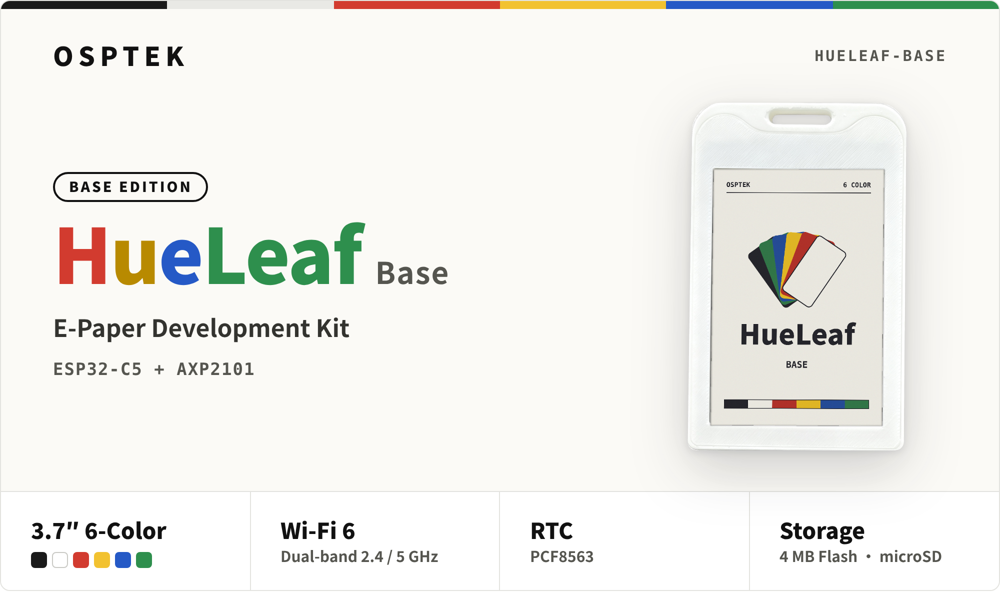

# HueLeaf Base

OSPTEK E-Paper Development Kit · ESP32-C5 · 3.7″ 6-Color E-Paper · Dual-band Wi-Fi 6

<p align="center">
  
</p>

<p align="center">
  
  
  
  
  
</p>

<p align="center">
  <a href="README.md">简体中文</a> &nbsp;|&nbsp; <b>English</b>
</p>


## Overview

HueLeaf is an e-paper development kit by OSPTEK. This repository covers its Base Edition.

The Base Edition is built around the ESP32-C5 and features a 3.7-inch six-color e-paper display capable of showing black, white, red, yellow, blue and green. The board integrates an AXP2101 power management IC, a PCF8563 RTC, an MSA321 accelerometer, an ST25R3916 NFC reader, 4 MB of Flash and a microSD slot, while the ESP32-C5 provides dual-band 2.4 GHz / 5 GHz Wi-Fi 6.

It comes in a badge-style enclosure, so it can be worn as an e-badge or placed on a desk. E-paper only draws power while refreshing; combined with the AXP2101's Li-ion battery management and the PCF8563's timed wake-up, the device can sleep for long periods and refresh on demand, making it well suited to long-term battery operation.

This repository is intended for secondary development and provides ESP-IDF-based examples, factory firmware and hardware files.

### Typical Use Cases

- E-badges and conference name tags
- Desk calendars and weather clocks
- Info dashboards and notifications
- Electronic shelf labels and door signs

## Specifications

| Item | Spec |
| :--- | :--- |
| MCU | ESP32-C5 (ESP32-C5HF4) |
| Display | 3.7″ 6-color e-paper EPD037A02, 480 × 720 (black, white, red, yellow, blue, green) |
| Wireless | Dual-band Wi-Fi 6, 2.4 / 5 GHz |
| PMU | AXP2101 |
| RTC | PCF8563 |
| Accelerometer | MSA321 |
| NFC | ST25R3916 |
| Storage | 4 MB Flash, microSD |
| USB | Type-C, ESP32-C5 native USB |
| Buttons | Reset, Power |
| LEDs | Charging (blue), Power on (green) |

Full schematic: [hardware/HueLeaf_Base_Schematic_V1.0.pdf](hardware/HueLeaf_Base_Schematic_V1.0.pdf).

### Pin Assignment

| Function | GPIO | Notes |
| :--- | :--- | :--- |
| SPI MOSI | 0 | Shared by e-paper and TF card |
| SPI CLK | 1 | Shared by e-paper and TF card |
| SPI MISO | 9 | TF card |
| E-paper CS / DC / RST / BUSY | 5 / 6 / 7 / 8 | |
| TF card CS | 10 | |
| I2C SDA / SCL | 2 / 3 | Shared by AXP2101, PCF8563, MSA321, ST25R3916 |
| Accelerometer interrupt | 4 | MSA321 |
| RTC interrupt | 23 | PCF8563 |
| NFC interrupt | 24 | ST25R3916 |
| PMIC interrupt | 25 | AXP2101 |
| NFC enable | 26 | |

| I2C Device | Address |
| :--- | :--- |
| AXP2101 | `0x34` |
| PCF8563 | `0x51` |
| MSA321 | `0x62` |
| ST25R3916 | `0x50` |

## Contents

| Directory | Contents |
| :--- | :--- |
| [`examples/`](examples) | Examples and factory firmware |
| [`hardware/`](hardware) | Schematic |

## Development Environment

Examples are developed with [ESP-IDF](https://github.com/espressif/esp-idf).

## Examples

### 3.7einkDvb Web Image Upload

Open a web page on your phone or computer and send images to the e-paper display. Source: [`examples/3.7einkDvb`](examples/3.7einkDvb).

#### Build and Flash

Connect the board via USB and run in the example directory:

```bash
cd examples/3.7einkDvb
idf.py build flash monitor
```

#### Wi-Fi Setup

1. On first boot, the screen shows a **Scan to setup** QR code.
2. Connect your phone to the device hotspot **`Eink E6 3.7`** (open, 5 GHz; your phone must support 5 GHz).
3. Scan the QR code on the screen, or open `http://192.168.4.1` in a browser.
4. Under Wi-Fi setup, choose a network, enter the password and connect.
5. Once connected, the hotspot turns off and the screen refreshes with a **Scan to upload** QR code, showing the device's LAN address below.

Wi-Fi credentials are saved on the device and used automatically on next boot. If it can't connect within 12 seconds, the setup hotspot opens again.

> [!NOTE]
> The example hard-codes the Wi-Fi country code to `CN` and runs the setup hotspot on 5 GHz channel 36. If you are in another country or region, change the country code in `examples/3.7einkDvb/main/wifi_mgr/wifi_mgr.c` and `WIFI_AP_CHANNEL` in `wifi_mgr.h` to comply with local radio regulations.

#### Sending Images

1. Switch your phone back to the Wi-Fi network you just configured, then scan the **Scan to upload** QR code to open the web page.
2. Choose an image under Image, or drag and drop / paste one.
3. Adjust the picture:
   - **Framing & rotation**: auto-cropped to the screen ratio; drag and zoom to frame, or rotate 90° left / right
   - **Light & color**: exposure, brightness, contrast, highlights, shadows, saturation
   - **Six-color mixing & style**: color / grayscale, dithering, denoising; enable the dithered-pixel view to preview
   - **Text**: add text on the image with adjustable size, color and background
4. Check the result in the screen preview, then send. The e-paper performs a full refresh.

#### Other Features

| Feature | Description |
| :--- | :--- |
| Clear screen | Refresh the screen to all white |
| Region replace | Replace only one area of the picture |
| Charging settings | Under Settings, choose the charge level and enter the battery's rated capacity (mAh) |
| NFC reading | Hold an NFC card near the device; data read is saved to `/sdcard/nfc/` on the TF card (TF card required) |

#### Screen Orientation

Rotated 180° by default. To change it, edit `EINK_ROTATION` in `examples/3.7einkDvb/main/pin_map.h` (`0` or `180`), then rebuild and flash.

## License

- Code (`examples/`): [Apache-2.0](LICENSE)
- Hardware files and documentation (`hardware/`, `docs/`): [CC BY-NC-SA 4.0](LICENSE-CC-BY-NC-SA-4.0)
- Third-party components (e.g. Vue) remain under their original licenses


<p align="center">
  <b>O S P T E K</b> &nbsp;·&nbsp; <code>HUELEAF-BASE</code>
</p>
